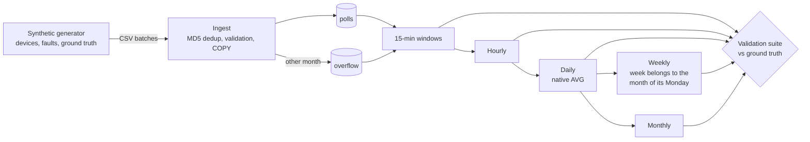

# access-network-telemetry

A from-scratch, synthetic-data pipeline that turns raw device polls from a fixed-access telecom
network (GPON fiber and HFC cable) into availability aggregates you can trust — and proves it
with a validation suite checked against ground truth.

> **Status: specification (M0).** This project is built spec-first. The full specification is in
> [`docs/spec.md`](docs/spec.md); implementation starts with milestone M1.

## Why this exists

Telemetry pipelines rarely fail on the happy path. They fail on duplicate files, renamed
duplicates, late batches from last month, collector gaps, out-of-order arrivals, timezone
boundaries and ISO weeks that cross a month. This project generates all of those on purpose,
labels them, and checks that the pipeline gets every one right.

All data is synthetic. No real network, company, site or table names are used.

## Planned design

Key rules, each explained in the spec:

- **Duplicates are detected by content (MD5), not by file name.** Ingest is idempotent.
- **A window with no polls is "no data", not "all offline".** A collection gap is not an outage.
- **Daily values use `AVG`, never `SUM`**, so missing hours do not distort the result.
- **An ISO week belongs to the month of its Monday**, so no week is counted in two months.
- **Monthly values come from daily ones**, not from weekly ones.
- **Late data is never dropped:** it is parked in `overflow` and the affected month is recomputed.
- **Calendar logic runs in local time** (configurable, default `America/Sao_Paulo`).

## Roadmap

| | Milestone | Done when |
|---|---|---|
| ☐ | **M1** Generator + ground truth | Same seed → identical files; every fault kind present |
| ☐ | **M2** Schema + ingest | Duplicate, renamed and malformed files handled; re-running changes nothing |
| ☐ | **M3** 15-min, hourly, daily | Completeness and reconciliation checks pass |
| ☐ | **M4** Weekly, monthly, overflow | The cross-month week lands in one month only; late files land in the right month |
| ☐ | **M5** Full check suite + CI | `make demo` green locally and in GitHub Actions |
| ☐ | **M6** README with results | Architecture, how to run, results in numbers |

## Stack

Python 3.11+, pandas, SQLAlchemy, psycopg2, PostgreSQL 16, pytest, GitHub Actions.

## How this is built

Spec-first and AI-assisted. The specification is written and reviewed before any code; every
behavior change starts as a change to `docs/spec.md`. The core data rules — rollup SQL, week
ownership and overflow handling — are written by hand. Scaffolding, the generator and the CLI
plumbing are written with [Claude Code](https://claude.com/claude-code) and reviewed line by line.

## License

[MIT](LICENSE) © 2026 Eric Guilherme
